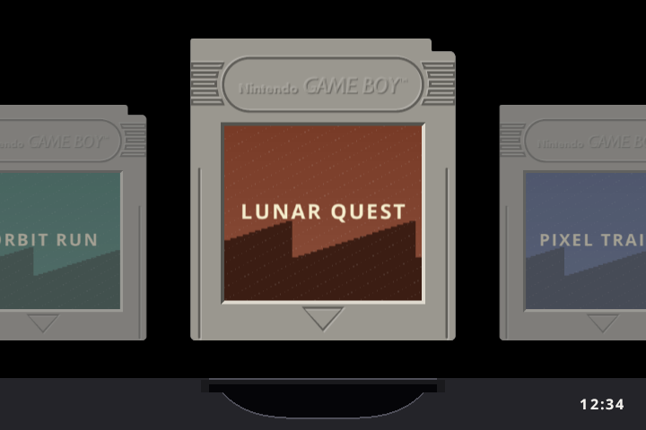
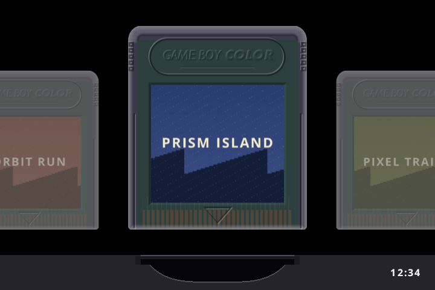
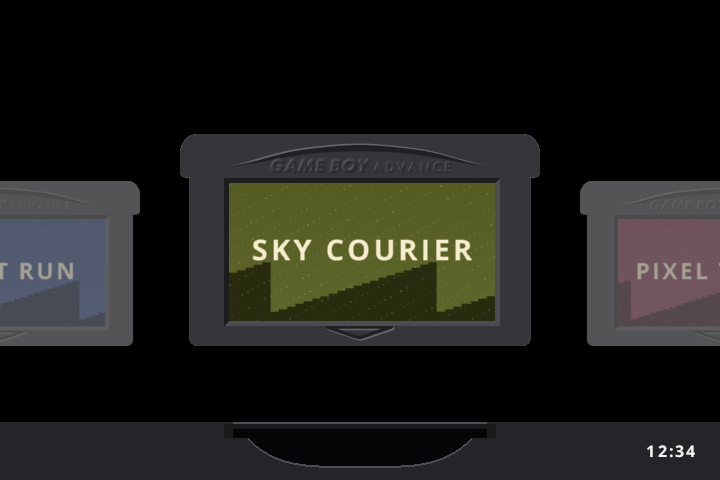
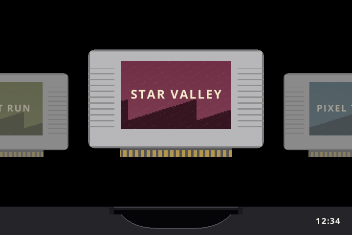
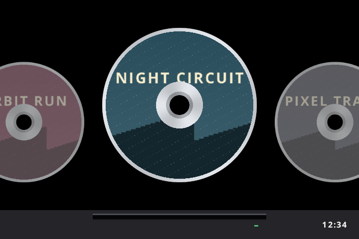
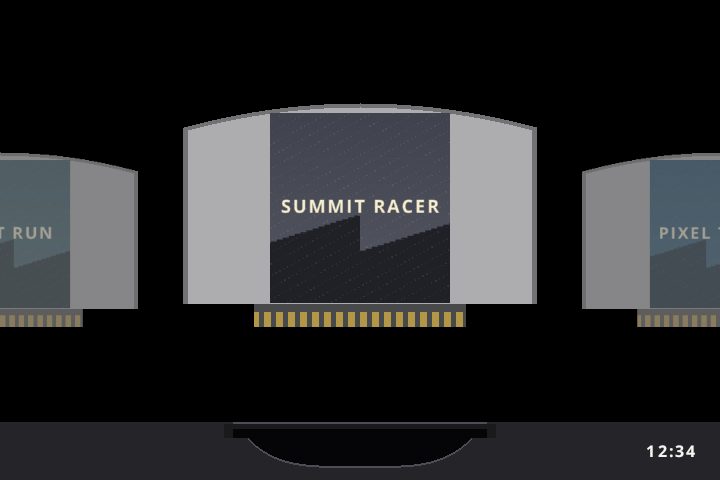
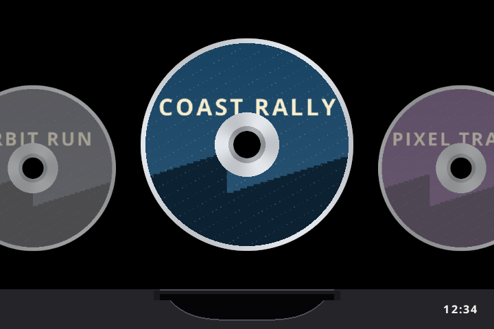
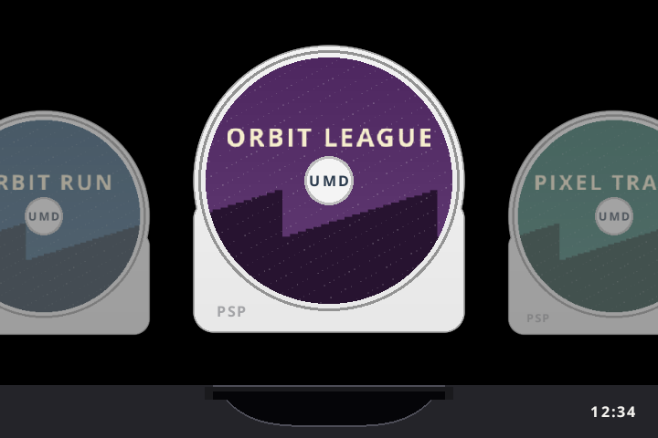
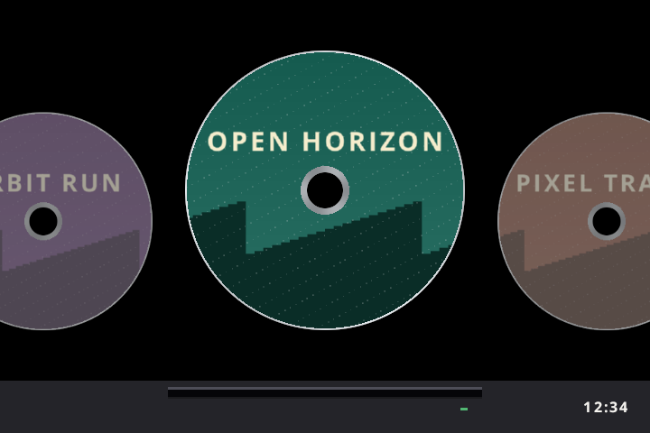

# Slot UI for BATLEXP G350, RG SP and RG35XX SP

A controller-friendly frontend with cartridge/disc shelves, save-state previews, shaders and long-press Menu to return home. This is an independent adaptation of [Slot](https://slot-cfw.fyi/), not an official Slot, PAN4ELEC or PortMaster release.

**Based on [Slot by Brandon Kowalski](https://github.com/BrandonKowalski/slot).** Credit for the original frontend and its visual foundation belongs to the upstream project and its contributors, including Markus for the skeuomorphic artwork credited upstream. See [credits and attribution](CREDITS.md).

**Release 1.1.15 uses the same version across G350, RG SP and RG35XX SP.** G350 image revision 3 includes the owner-tested Dreamcast audio fix and optimized N64 core, and keeps the removal of 117 unused legacy ROM folders. RG SP and RG35XX SP retain their verified image bytes. Internal frontend build numbers remain 0.1.14, 0.3.1 and 0.2.3 respectively. Only these three current release pages are retained.

**The latest complete images include native Ports and a bundled PortMaster manager**, round CDs, a gray SLOT splash on black, and in-game volume buttons that inherit Slot's saved speaker/headphone levels. The owner has confirmed GTA SA and NFS U2 launch and play; NFS U2 remains demanding and runs slowly. Compatibility and speed vary by port.

**Current G350 source baseline (2026-10-19):** owner-tested threaded Dreamcast audio/rendering and an optimized N64 core are now the accepted runtime. Diddy Kong Racing improves, but demanding N64 scenes can still slow down. The [validation notes](docs/G350-2026-10-19-N64-VALIDATION.json) explain the comparison. **The G350 1.1.15 revision 3 downloads include these performance changes.** See [source build instructions](docs/G350-BUILD.md). RG SP/RG35XX SP downloads are unchanged.

## Screenshots

All eight emulated systems and the native Ports shelf, shown with cartridge/disc labels. These are captures from Slot's actual shelf renderer on its 720 × 480 reference canvas, using original fictional demo artwork. They show the frontend rather than gameplay; physical panel layouts vary by model. Your own PNG labels replace the demo prints. See [how to add labels](#adding-ports-and-disc-labels).

| Game Boy · GB | Game Boy Color · GBC | Game Boy Advance · GBA |
|:---:|:---:|:---:|
|  |  |  |

| Super Nintendo · SNES | PlayStation · PS1 | Nintendo 64 · N64 |
|:---:|:---:|:---:|
|  |  |  |

| Dreamcast · DC | PlayStation Portable · PSP | Native games · Ports |
|:---:|:---:|:---:|
|  |  |  |

## Downloads and installation

| Device | Fresh installation | Guide / optional system files |
|---|---|---|
| G350 | [1.1.15 complete image](https://github.com/nikunjsingh93/Slot-UI-More/releases/tag/g350-v1.1.15) | [1.1.15 system files](https://github.com/nikunjsingh93/Slot-UI-More/releases/tag/g350-v1.1.15) · [step-by-step G350 guide](docs/G350-INSTALL-AND-PORTS.md) |
| RG35XX SP | [1.1.15 complete image](https://github.com/nikunjsingh93/Slot-UI-More/releases/tag/rg35xxsp-v1.1.15) | [RG35XX SP instructions](ports/rg35xxsp/README.md) |
| RG SP | [1.1.15 complete image](https://github.com/nikunjsingh93/Slot-UI-More/releases/tag/rgsp-v1.1.15) | [RG SP instructions](ports/rgsp/README.md) |

**Use only the image for your exact model.** Each model has its own native-port launcher/runtime. H700 native Ports are experimental and await physical testing. Flashing a fresh image erases the target card. Updating an existing G350 uses SYSTEM + SYSTEM.md5 and, for the 0.1.13 boot artwork, KERNEL + KERNEL.md5. No card reflash is required for an update. Keep games, labels and saves backed up before changing firmware.

The repository and current releases are public. No games, proprietary BIOS, APKs/OBBs, private game-linked executables, save files or commercial disc scans are supplied in the latest sharing packages. Each fresh `.img.zip` contains the current firmware and manager setup; no earlier image or follow-up update is needed. Update ZIPs are also available for existing cards. Original emulator core binaries are retained from the accepted G350 base.

## Quick start on G350

1. Flash the complete G350 image, or update your existing card, following the [installation guide](docs/G350-INSTALL-AND-PORTS.md).
2. Copy your own games to `GAMES/Slot/Games/<SYSTEM>/` (the folder table is in the guide).
3. For native ports, open the bundled PortMaster from the Ports shelf, install games and supply any required files from your own copies. G350 installs the manager automatically on its first boot and preserves existing installs. PortMaster itself is already published by its upstream authors; this repository supplies the Slot integration.
4. Put labels in `GAMES/Slot/Labels/<SYSTEM>/`, with the exact game filename stem and `.png`. For example, `Games/PS1/My Game.chd` uses `Labels/PS1/My Game.png`.
5. Safely eject, boot, switch shelves with L1/R1 and press A to play. Hold the centre M/Menu button alone for one second to return to Slot.

For RG SP / RG35XX SP, follow [the H700 Ports guide](ports/h700/README.md). It uses different paths and a pinned H700-compatible manager; do not copy the G350 runtime onto it.

## Artwork Studio

**[Open Artwork Studio online](https://nikunjsingh93.github.io/Slot-UI-More/)** — no download or installation needed. Use Chrome or Edge for direct folder saving.

Open [Artwork Studio v5](studio/Slot-Auto-Artwork-Studio-v5.html) in Chrome or Edge, or download its standalone HTML/ZIP from any current device release. **One app handles GB, GBC, GBA, SNES, PS1, N64, Dreamcast and PSP.** Choose the Slot folder (or BASEOS on the H700 devices), let it fetch cartridge/disc artwork, then save all ready labels together. Existing labels, including ones from Cart Studio, are preserved unless replacement is enabled. You can also export a Labels ZIP. No firmware update is needed. See the [studio guide](studio/README.md) for paths, scan adjustments and fallbacks. Artwork downloaded for personal use is not a license to redistribute it.

The site fetches third-party images on demand rather than hosting an artwork library. See [image sources, permissions and privacy](studio/ARTWORK-SOURCES.md); the app's code license does not grant rights to the downloaded game artwork.

## Adding ports and disc labels

Installed top-level `.sh` launchers under `GAMES/ports/` are imported into the Ports shelf at startup and after returning from a port. Game data stays in each port's own folder. `Slot/Games/PORTS/*.port` contains small launch descriptors, not PC game files.

```text
GAMES/
  ports/
    My Game.sh
    mygame/
      ...port runtime and your required data...
  Slot/
    Games/PORTS/My Game.port      (created automatically)
    Labels/PORTS/My Game.png     (optional disc print)
```

Use launcher names containing ASCII letters/numbers, spaces, dots, underscores, hyphens or parentheses. Use the same spelling and capitalization for the PNG. A square PNG (for example 512 × 512) with the disc face centered works well; Slot clips it to a round CD and draws its hub. Missing labels use the generic disc. Restart Slot/the handheld after copying artwork. The current Artwork Studio covers SNES/PS1/N64/DC/PSP; custom Ports labels are added manually.

**SP native-input test update (not yet in stable full images):** on RG SP/RG35XX SP, Menu + Select switches native games between D-pad and left-stick input and remembers each game's choice. Hardware validation is pending; the manager stays digital. Named GTA SA/NFS U2 virtual-controller profiles are included; game files are supplied separately. See [setup, rollback and limitations](ports/h700/README.md#controls-and-limits).

**Native port controls:** hold Menu alone for one second to quit. Volume +/− changes the current speaker/headphone level; holding repeats; both together toggle mute. Use the game's own save menu. Emulator save states, double-Menu state browsing and Slot shaders do not apply to native ports. Some third-party launch scripts can override audio/input settings and need adaptation.

## Controls and hotkeys

These are the emulator controls retained in G350 0.1.14, checked against the input/session code. **Menu** means the handheld's centre **M** button; L1/R1 are the first shoulder buttons and L2/R2 the second pair. For a combination, hold the first button, tap the second, then release both. A long hold of Menu **alone** quits the game.

### Save and load by system

| System / bundled emulator | Save a state while playing | Load the newest saved state |
|---|---|---|
| PS1 / PCSX ReARMed | Menu + X | Menu + Y |
| SNES / Snes9x 2005 Plus (or Snes9x) | Menu + X | Menu + Y |
| N64 / ParaLLEl N64 (or Mupen64Plus Next) | Menu + X | Menu + Y |
| Dreamcast / Flycast | Menu + X | Menu + Y |
| PSP / PPSSPP | Menu + X | Menu + Y |
| GBA / mGBA or gpSP | Select + R1 | Select + L1 |
| GB / mGBA | Select + R1 | Select + L1 |
| GBC / mGBA | Select + R1 | Select + L1 |

For Game Boy **Select** combinations, press the second button promptly, within about **0.6 seconds** of pressing Select. Holding Select longer hands it to the game instead. For example, on PS1: hold M, tap X, release both to save; hold M, tap Y, release both to load.

Save states are emulator snapshots, separate from a game's normal memory-card/VMU/memory-stick saves. Loading restores the saved moment. Use the browser below to choose an older state; the quick load shortcut chooses the newest saved state. Normal game saves remain managed through each game's own save menu.

### Common controls while playing emulators

| Button / action | Result |
|---|---|
| Hold Menu alone for about 1 second | Save the resume data and return to the Slot shelf |
| Double-tap Menu quickly (within about 0.35 seconds) | Open the saved-state picture browser, if this game has saved states |
| Volume + / Volume − | Adjust the current speaker/headphone volume; holding repeats |
| Press both volume buttons together | Toggle mute; press them together again to unmute |
| Tap Power | Sleep / wake |
| Hold Power for about 1 second | Open Restart / Power off; select with Up/Down, confirm with A, cancel with B |
| PS1 only: Menu + R2 | Cycle to the next disc in a loaded multi-disc playlist |

For PS1 disc switching, launch the game's `.m3u` playlist with all discs listed, then use Menu + R2 when the game requests the next disc. A single-disc file has no next disc. PSP and Dreamcast do not have this disc-switch shortcut.

### Saved-state picture browser (emulated systems)

Double-tap Menu during gameplay to open it. Gameplay pauses while the browser is open.

| Button | Result |
|---|---|
| Left / Right | Choose a saved state |
| A | Load the selected state and resume |
| B, or double-tap Menu again | Close the browser and resume |
| X | Undo the most recent manual save/load, when offered (within 30 seconds) |
| Y | Delete the selected saved state |

### Extra Game Boy shortcuts (GBA / GB / GBC)

These apply while playing Game Boy systems. On PS1/SNES/N64/DC/PSP, the face, shoulder, Start and Select buttons go to the game instead; L2/R2 do **not** trigger rewind/fast-forward there, and Select combinations do **not** adjust display settings there. Return to the shelf for those settings.

| Button / combination | Result |
|---|---|
| Hold L2 | Rewind; release to play normally |
| Hold R2 | Fast-forward; release to play normally |
| Double-tap R2 quickly | Keep fast-forward on; tap R2 again to stop |
| Hold X / hold Y | Turbo A / turbo B |
| Select + Up / Down | Increase / decrease brightness |
| Select + Right / Left | Increase / decrease blue-light filtering |
| Select + Y | Toggle colour correction |
| GB/GBC only: L1 alone | Alternate full-screen stretch and full-height with aspect-preserving side bars |
| GB/GBC only: R1 alone | Restore the old centered default picture |
| GBA only: Select + Menu | Open Slot's link-play menu for a supported game/core; G350 multiplayer connectivity has not been validated |

Load-state, rewind and fast-forward are unavailable during an active link-play session. Select remains a normal game button when tapped on its own.

### Slot shelf and settings

| Button | Result |
|---|---|
| Left / Right | Browse games; holding continues scrolling |
| Up / Down | Jump to the previous / next starting letter |
| L1 / R1 | Switch system shelves |
| A | Launch the selected game |
| Tap Menu | Open settings; B or Menu closes them |
| Start on a GBA game | Choose mGBA / gpSP: Left/Right chooses, A keeps the choice, B cancels |

In settings, Up/Down selects a row, Left/Right changes its value, and A opens the selected item. The volume and Power controls above also work on the shelf. The Shader row selects Original, Sharp Pixels, Smooth, LCD or CRT; it is global and saved automatically. GB/GBC scaling is saved per game. The 0.1.10 SYSTEM update is required for these new options; no full reflash is needed.


## Source, building and validation

- `slot/`: customized Rust frontend, renderer, input/audio code and tests.
- `firmware/ports/`: native launcher, Menu/volume supervisor, input-sharing helper, installation and splash tools.
- `firmware/slot-start`: G350 boot/provisioning and port process lifecycle.
- `studio/`: artwork tool and editable source.
- `ports/rg35xxsp/`, `ports/rgsp/`: separate Anbernic adaptations.
- `patches/`, `scripts/`, `docs/`: pinned core sources, build recipes, provenance and validation.

For the ARM64 Bullseye build environment, core source downloads and the current Ports overlay recipe, see [building](docs/G350-BUILD.md). The NFS matching-executable recipe is in [firmware/ports/nfs](firmware/ports/nfs/README.md); generated guest code and its resulting executable must remain private.

The G350 0.1.13 baseline passed frontend/disc geometry tests, Menu/volume process tests, real ALSA PCM gain tests with a mocked hardware mixer, script/dependency checks, archive integrity and uncached SD read-back. All 50 save files, both working private game runtimes and Slot settings were unchanged during the owner's update. The owner reports the current setup works well; NFS speed remains limited. This is not a guarantee that every G350 revision, emulator or downloaded port works. Historical release notes remain under `docs/`.

## Sharing, licenses and credits

Original Slot: **[Brandon Kowalski and contributors](https://github.com/BrandonKowalski/slot)**. This repository adds its own device adaptations, emulator/Ports integration and combined Artwork Studio. It is independently maintained and is not endorsed by the upstream authors. [CREDITS.md](CREDITS.md) records the source baseline and third-party attribution.

The Slot code is GPL-3.0; retain [LICENSE](LICENSE), upstream notices and source. PortMaster GUI is separately developed by [PortsMaster](https://github.com/PortsMaster/PortMaster-GUI) under its [MIT license](https://github.com/PortsMaster/PortMaster-GUI/blob/main/LICENSE); included utilities and individual games have their own licenses. Emulator and OS components have separate terms, including GPL, MPL and component-specific restrictions. The root GPL license does not relicense those components or commercial games/artwork.

You can share the original/modification source under the applicable licenses. When distributing binaries, provide the complete corresponding source and build/install material required by the relevant licenses alongside them; a link to a newer upstream branch alone is not a substitute for the source used. Preserve the older source assets referenced in [the sharing notes](docs/SHARING.md). Before making all firmware releases public, review their contents, component license conditions and corresponding-source coverage. The current review is not a complete legal clearance of every historical firmware dependency. See [GNU's distribution guidance](https://www.gnu.org/licenses/gpl-faq.html#SourceAndBinaryOnDifferentSites).

Users provide their own legally obtained game files and any required BIOS. Never upload ROMs, SPEED2.EXE, generated NFS guest code/game-linked executables, GTA APKs/OBBs/libraries, saves or commercial artwork scans. The personal update containing disc scans is kept local; the sharing package excludes them.
