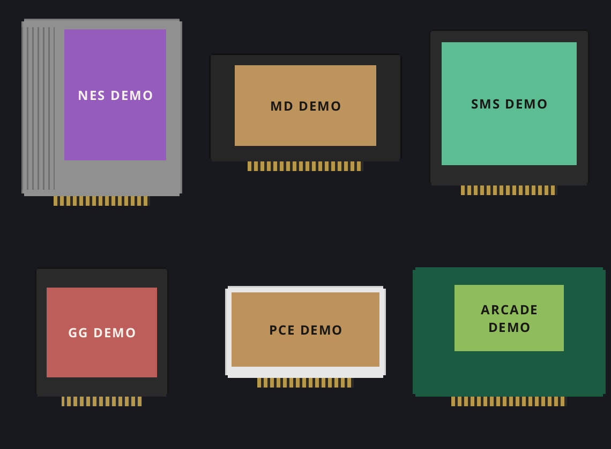

# NES, Sega, PC Engine and Arcade

Included in the **1.1.17 complete images** for G350, RG SP and RG35XX SP,
with one matching flash image per device. Earlier 1.1.16 images lack these added
systems. Artwork Studio is included under Tools and published on GitHub Pages.
No physical SD card was written during release packaging; new-system gameplay
and fresh-image first boot still need handheld testing.

| System | Folder under `Games/` | Files | Core | Label PNG size |
|---|---|---|---|---|
| NES / Famicom cartridges | NES | `.nes`, `.unf`, `.unif` | FCEUmm | 190×245 |
| Sega Mega Drive / Genesis | MD | `.md`, `.gen`, `.bin`, `.smd` | Genesis Plus GX | 264×151 |
| Sega Master System | SMS | `.sms` | Genesis Plus GX | 252×230 |
| Sega Game Gear | GG | `.gg` | Genesis Plus GX | 206×168 |
| PC Engine / TurboGrafx-16 HuCards | PCE | `.pce` | Beetle PCE Fast | 276×139 |
| Arcade, including supported Neo Geo games | ARCADE | `.zip` | FinalBurn Neo | 204×124 |

On G350 these folders are inside `GAMES/Slot`; on the SP cards they are inside
the BASEOS card root. Example: `Slot/Games/NES/My Game.nes` on G350 and
`Games/NES/My Game.nes` on RG SP. Keep console cartridges uncompressed.
Labels go in `Labels/<SYSTEM>/<exact ROM filename stem>.png`.

These additions do not include Sega CD, 32X, Saturn, PC Engine CD, SuperGrafx,
Famicom Disk System or every historical arcade machine. No game or proprietary
BIOS files are bundled. Older games are generally a much lighter workload than
N64/Dreamcast, but no blanket full-speed claim or handheld test is made here.

## Arcade files

Use game sets matching **FBNeo commit
`2b0c1c0679df115cada7df9199ea2762222e58fd`** (DAT version 1.0.0.03).
The exact `FBNeo-Arcade.dat` accompanies the core package. The commit and DAT
matter: the displayed version number alone does not identify a compatible set.
Random MAME ZIPs are not interchangeable with FBNeo sets.

Keep archive names such as `sf2.zip` unchanged and do not extract them.
Non-merged sets are simplest; a split clone also needs its matching parent
archive alongside it in `Games/ARCADE`. Required BIOS archives, for example a
matching `neogeo.zip`, can go in `BIOS/fbneo/`. The core also searches `BIOS/`
and the game directory. Recognized BIOS archives in the game folder are hidden
from the game shelf. Neo Geo game ZIPs stay in `Games/ARCADE`.
Supply BIOS/game data yourself. Samples, if needed, belong in
`BIOS/fbneo/samples/`. See the [official FBNeo guide](https://docs.libretro.com/library/fbneo/).

Only ordinary joypad games are covered by this integration. Lightguns, trackballs,
keyboards, multiplayer controls and unusual dedicated cabinets are not configured.
Modern/large arcade titles can exceed these handhelds' performance or memory limits.

## Controls

- **Hold Menu alone for about one second:** return to Slot.
- **Menu + X:** save state. **Menu + Y:** load newest state.
- **D-pad, face buttons and shoulders:** game controls, using each core's RetroPad mapping.
- **Arcade Select:** insert coin. **Start:** start the game.
- Genesis uses B=B, Y=A, A=C, X=Y, L1=X, R1=Z; Select=Mode.
  The core detects 3/6-button compatibility from the game.
- Master System/Game Gear: B=button 1, A=button 2. Start is pause/start.
- NES: B=B, A=A; Start/Select pass to the game. Extra face buttons follow
  FCEUmm's default mappings; X/Y alone never save or load Slot states.

The original Game Boy shoulder/stretch and turbo shortcuts are not intercepted
in these systems. New consoles use the normal console state shortcuts.
The H700 per-system **Screen Size: Default / Full** setting includes every new
system; Default preserves 4:3 consoles and the Game Gear's 10:9 picture.
Portrait arcade games are rotated upright and fitted within the 4:3 game area.

## Artwork

Choose the Slot/BASEOS folder once in the updated standalone Artwork Studio.
NES/MD/SMS/GG/PCE prefer physical cartridge scans when available, then logos or
covers. Arcade prefers logos/covers on an original PCB-style shell. The pinned
FBNeo driver database converts short ZIP names to full titles for artwork matching
and friendly fallback titles; output labels still use `sf2.png`, not the expanded
title. BIOS archives are skipped. Uncertain matches remain selectable manually.
No ROM contents are read or uploaded for matching.

New indexes use pinned Libretro thumbnail repository revisions (embedded in
`studio/source/catalog.json`) and the cached 2026-10-09 LaunchBox metadata snapshot.
The app embeds names/image identifiers, not downloaded commercial artwork.
See [artwork sources and privacy](../studio/ARTWORK-SOURCES.md).

## Build and provenance

`additional-core-sources.json` pins source archive SHA-256 and commits for all
four cores. Build with `scripts/build_extra_cores.py` inside the ARM64 Bullseye
environment; no commercial inputs are required. Output includes notices,
corresponding source archives, the arcade DAT and binary hashes. The generic
ARMv8-A software builds serve both RK3326 and H700.

FCEUmm/Beetle PCE Fast, Genesis Plus GX and FBNeo retain their own component
licenses. Genesis Plus GX and FBNeo include noncommercial restrictions; FBNeo
also prohibits requesting donations for a project using its source. Preserve
the complete supplied notices and source archives. The combined firmware is
not licensed solely under Slot's GPL. Official technical references:
[FCEUmm](https://docs.libretro.com/library/fceumm/),
[Genesis Plus GX](https://docs.libretro.com/library/genesis_plus_gx/),
[Beetle PCE Fast](https://docs.libretro.com/library/beetle_pce_fast/),
[FinalBurn Neo](https://docs.libretro.com/library/fbneo/).

## Validation limits

The original test-ROM generator is `scripts/tests/make_extra_test_roms.py`.
`extra_smoke` runs real NES/MD/SMS/GG/PCE cores for video/PCM/state roundtrips;
it does not measure handheld performance or game compatibility. Arcade invalid
archives and synthetic rotation/letterbox frames are tested; a real compatible
arcade game still needs handheld verification. Independent G350/H700 build and
control tests cover the new mappings. `studio/source/test-extra-systems.cjs`
tests matching, BIOS filtering, label dimensions, ZIP/direct saving, existing
label preservation, nested folders and mobile layout without reading ROMs.
